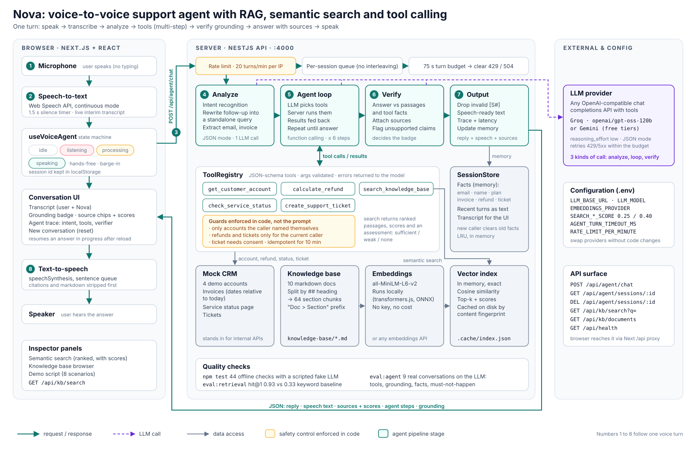

# Nova: Voice-to-Voice Support Agent with RAG, Semantic Search and Agentic AI

A web app where you **talk** to an AI support agent for *CloudNest*, a fictional cloud storage company. Nova listens through your microphone, understands the request, searches a knowledge base by meaning, calls tools (account lookup, refund calculator, service status, ticketing) across several steps when needed, and **speaks** a grounded answer back, with the source documents shown on screen.

**Stack:** NestJS (API, agent, RAG) · Next.js 14 + React + Tailwind (voice UI) · local sentence embeddings (transformers.js) · any OpenAI-compatible LLM with tool calling (free Groq or Gemini key).

Everything runs on free tiers. Embeddings run locally and need no key at all.

---

## Quick start (about 5 minutes)

**Requirements:** Node.js 18.18+ (20+ recommended), Chrome or Edge (for the browser speech APIs), and one free LLM key.

1. **Get a free LLM key** (pick one):
   - Groq: <https://console.groq.com/keys> (fast, recommended)
   - Google Gemini: <https://aistudio.google.com/apikey>

2. **Install and configure**
   ```bash
   npm run setup          # installs root, backend and frontend; creates backend/.env
   ```
   Open `backend/.env` and paste the key into `LLM_API_KEY`. For Gemini, switch the three `LLM_*` lines to the Option B block.

3. **Run**
   ```bash
   npm run dev            # API on :4000, web app on :3000
   ```
   Open <http://localhost:3000> in Chrome, allow the microphone, press the mic (or the space bar) and talk.

   The first backend start downloads the embedding model (about 25 MB) and indexes the knowledge base. The header shows "indexing" until it is ready (usually under a minute). After that the index is cached in `backend/.cache/`.

4. **Optional: check quality** (see [Testing and evaluation](#testing-and-evaluation))
   ```bash
   npm test                 # 44 offline checks, no key needed
   npm run eval:retrieval   # semantic search vs keyword baseline
   npm run eval:agent       # real conversations against the real LLM
   ```

<details>
<summary>Running the two apps separately</summary>

```bash
cd backend && cp .env.example .env && npm install && npm run start:dev
cd frontend && npm install && npm run dev
```
If the backend runs elsewhere, set `BACKEND_URL` for the frontend (default `http://localhost:4000`).
</details>

---

## Demo script

The right-hand panel of the app has these scenarios with a "send" button each, but they are meant to be **spoken**. Say 3, 4 and 5 in order since they build on each other.

| # | Say this | What it demonstrates |
|---|----------|----------------------|
| 1 | "How long do I have to get a full refund after I pay?" | Voice in, voice out; **grounded answer** with cited sources |
| 2 | "What happens to stuff I throw away? Can I get it back?" | **Semantic retrieval**: the doc says "Recycle Bin", "removed", "restored"; none of the user's words |
| 3 | "Hi, I'm sara at example dot com. I think I got charged twice for Pro this month. Can I get my money back?" | **Agentic multi-step**: `get_customer_account` → finds two identical invoices → `search_knowledge_base` (refund policy) → `calculate_refund` → answer with amount, offers a ticket |
| 4 | "Yes please, open a ticket for that." | **Contextual follow-up**: reuses email, invoice id and refund amount from memory → `create_support_ticket`, reads back the ticket id |
| 5 | "And how fast will someone reply on my plan?" | Follow-up resolution ("my plan" = Pro from memory) + retrieval |
| 6 | "Do you have a student discount?" | **Insufficient information**: retrieval finds the *nonprofit* discount (related but not an answer); the agent says the help center doesn't cover student pricing instead of guessing |
| 7 | "My files aren't syncing to my phone. What's going on?" | Two tools combined: `check_service_status` (live EU sync incident) + troubleshooting docs |
| 8 | "This is a different account, ali at example dot com. If I cancel my Business plan now, how much would I get back?" | Caller switch (old account facts are dropped) + a different policy branch: prorated annual refund computed by the tool, not by the LLM |

Every assistant message shows: the detected **intent**, a **grounding badge** (grounded / not covered / from tools), **source chips** with similarity scores you can expand to read the passage, and a collapsible **agent trace** with each step, tool arguments, results and timings.

Demo accounts (mock CRM): `sara@example.com` (Pro monthly, duplicate charge), `ali@example.com` (Business annual, 20 days old), `maria@example.com` (Pro annual, 41 days old, not refundable), `john@example.com` (Free, storage nearly full). Dates are generated relative to today so outcomes are the same whenever you run it.

---

## Architecture



Numbers 1 to 8 follow one voice turn. A PNG version is in `docs/architecture.png`.

### One turn, step by step

1. **Speech to text (browser).** The Web Speech API runs in continuous mode with a custom 1.5 s silence timer, so longer utterances like a spelled email are not cut off. Interim text is shown live.
2. **Analyze (1 small LLM call, JSON mode).** Classifies the **intent** (`knowledge_question`, `account_request`, `troubleshooting`, `small_talk`, `out_of_scope`), rewrites follow-ups into a **standalone query** ("what about annual?" → "What is the refund policy for annual plans?"), extracts **entities** (email, invoice id, plan) into session memory, and sketches a plan. This is shown in the trace and passed to the main loop as a hint.
3. **Agent loop (ReAct via native function calling).** The LLM gets the system prompt, recent conversation (as plain text), remembered facts and 5 tools. It decides which tools to call; the server runs them and feeds results back; this repeats until the model answers or hits 6 steps (on the last step `tool_choice: none` forces an answer from what it has).
4. **Retrieval evaluation.** `search_knowledge_base` returns ranked passages *and* an `assessment` (`sufficient`, `weak`, `none`) based on similarity thresholds, plus guidance. The prompt requires one re-query with different wording on weak results, and an explicit "I don't have reliable information on that" if it is still insufficient, or if the passages don't contain the specific fact asked.
5. **Grounding check (verifier).** Whenever the knowledge base was used, a second strict LLM call compares the final answer with the retrieved passages and the tool results. It returns which passages support it and which claims nothing supports. That decides the badge (grounded / partly supported / not covered) and attaches sources even when the model forgot to cite them. Unsupported claims are shown under the answer. The refund tool also attaches the exact policy passage its rule comes from, so refund answers are always citable.
6. **Post-processing.** `[S#]` citations are mapped back to retrieved chunks (unknown ids are stripped so the transcript can't show fake citations), a grounding status is computed, and a speech version is produced (no citations or markdown; `INV-1043` is read as "invoice 1043").
7. **Text to speech (browser).** The reply is split into sentences and queued, which avoids Chrome's cut-off on long utterances. Clicking the mic while Nova talks interrupts it (barge-in). Hands-free mode reopens the mic after each reply.

---

## How each requirement is met

| Requirement | Implementation |
|---|---|
| Voice input, STT | `frontend/hooks/useSpeechRecognition.ts` (Web Speech API, silence detection, error mapping) |
| Spoken responses | `frontend/hooks/useSpeechSynthesis.ts` (sentence queue, voice selection, cancel) |
| Transcript, history, reset | Transcript in the UI; server-side session (`SessionStore`) restored on reload via `GET /api/agent/sessions/:id`; "New conversation" deletes it |
| Listening / processing / responding states | `useVoiceAgent` state machine drives the orb, labels and colors |
| No typing required | Mic button or space bar; typing is an optional fallback for Firefox |
| Knowledge base | 10 markdown help-center docs in `knowledge-base/` (64 section-level chunks) |
| Grounded answers + sources | Prompt rules + `[S#]` citations mapped to chunks, shown as expandable source chips with scores |
| Unsupported questions | `assessment` from the search tool, re-query rule, "missing is not the same as no" prompt rule, verifier flags unsupported claims, "Not covered" / "Partly supported" badges |
| Semantic search, ranked with scores | `KbService.search` (cosine similarity on sentence embeddings); `GET /api/kb/search`; "Semantic search" tab in the UI |
| Different wording still matches | Demo scenarios 2 and 6; `npm run eval:retrieval` compares against a keyword baseline on 15 paraphrased questions |
| Intent recognition | Analyzer step (visible in the trace) + the model's own tool choice |
| ≥ 2 tools | 5 tools in `backend/src/tools/tool.registry.ts` |
| Multi-step execution | Up to 6 LLM ↔ tool rounds per turn; scenario 3 uses 3 to 4 tool calls |
| Retrieval evaluation | `sufficient / weak / none` assessment + guidance returned to the model, then a post-answer verifier |
| Conversation memory | Recent turns as plain text + a `facts` map (email, plan, invoice id, refund amount, ticket id) injected into the system prompt; a new caller identity clears the old facts |
| Context-aware, no re-asking | Facts are reused by the prompt rules; the analyzer rewrites follow-ups into standalone queries |

---

## Key technical decisions

**Browser speech APIs instead of cloud STT/TTS.** Zero keys, zero cost, almost no latency, and a reviewer can run it instantly. The trade-off is browser support (Chrome and Edge are best; Firefox has no recognition) and voice quality. The voice layer is isolated in two hooks, so swapping in Whisper or a neural TTS means replacing those hooks plus one upload endpoint; nothing else changes.

**Local embeddings (all-MiniLM-L6-v2 via transformers.js).** Free, offline after the first download, deterministic (the index is reproducible and cached by a content fingerprint), and it keeps retrieval independent of whichever LLM provider is used. A 384-dimension model is small, but section-level chunks with a "Document > Section" prefix give it enough context. `EMBEDDINGS_PROVIDER=api` switches to a hosted embedding model.

**Flat in-memory vector index.** At 64 chunks, exact cosine search takes well under a millisecond and needs no infrastructure for the reviewer to set up. The `search(query, k) → ranked hits with scores` interface is what a pgvector or Qdrant implementation would provide at scale.

**Structure-aware chunking.** Docs are split on `##` headings so each chunk is one topic (a policy clause, a troubleshooting step), long sections are split on paragraphs with overlap. This makes citations precise ("Refund Policy › Duplicate charges") instead of pointing at a whole document.

**Provider-agnostic LLM client on plain `fetch`.** Any OpenAI-compatible `/chat/completions` endpoint with tools works (Groq, Gemini, OpenRouter, OpenAI, local Ollama), chosen in `.env`. The client handles what free tiers actually do: 429s with `Retry-After`, 5xx, timeouts, and the occasional malformed tool call from open models.

**Business logic lives in tools, not in the prompt.** Refund eligibility and amounts are computed by `calculate_refund` in code that mirrors the written policy, so the LLM explains a number instead of doing date arithmetic. The knowledge base is still searched so the explanation is cited. Side-effecting actions (tickets) require the customer's agreement, and refunds are never "issued" by the agent.

**Separate analyzer step.** It costs one small extra call, but it makes intent recognition and follow-up rewriting explicit and inspectable, and stores entities from speech (including "sara at example dot com") in memory even before any tool runs. If it fails, the turn continues without it.

**Grounding is verified, not trusted.** Small models drop citations, invent them, or turn "the docs don't say" into "we don't offer". So citations that don't match a retrieved chunk are removed, and a separate verifier call decides grounding and attaches sources. Similarity thresholds alone can't do this: in the retrieval eval, "student discount" (not answerable) scores 0.36 while "Is my stuff kept in Europe?" (answerable) scores 0.35.

**Compact memory instead of replaying tool payloads.** The first version replayed every past tool call and result. Prompts grew by thousands of tokens per turn, which hit free-tier token-per-minute limits and produced 60 to 80 second turns. Now earlier turns are plain text and anything needed later (email, invoice, refund amount, ticket id) is stored as a fact.

**Safety rules enforced in code, not just in the prompt.** Prompts are requests; code is a guarantee.
- The agent can only look up an account the caller named themselves in this conversation, so a confused model, or text injected through a document or tool result, can't pull up another customer's data.
- Refund calculations and tickets only work on the account looked up for the current caller; switching caller blocks actions on the previous account.
- A ticket (the only side effect) is created only if the caller's own words this turn show agreement ("yes", "please", "open a ticket"...).
- Each IP gets at most 20 agent turns per minute (`RATE_LIMIT_PER_MINUTE`), which protects the LLM key from being burned by a script.

**Reliability.** Turns for one session are serialized (a queue), so a double-submit or reload can't interleave history. Each turn has a 75 s budget; rate-limit retries stop when the budget runs out and the user gets a clear "rate-limited, try again" message. Ticket creation is idempotent for 10 minutes. A failed turn is recorded in the transcript, and a reloaded page resumes waiting for an in-progress answer.

---

## API

| Method | Path | Purpose |
|---|---|---|
| POST | `/api/agent/chat` `{ sessionId?, message }` | One agent turn → reply, speech text, sources, steps, intent, grounding |
| GET | `/api/agent/sessions/:id` | Transcript + remembered facts |
| DELETE | `/api/agent/sessions/:id` | Reset conversation |
| GET | `/api/agent/tools` | Tool schemas the LLM sees |
| GET | `/api/agent/tickets` | Tickets created this run |
| GET | `/api/kb/search?q=...&k=5` | Semantic search with scores |
| GET | `/api/kb/documents` | Documents and sections |
| GET | `/api/health` | LLM configured?, index ready?, chunk count |

---

## Project structure

```
knowledge-base/                 10 CloudNest help-center articles (markdown)
backend/src/
  agent/        agent.service.ts (analyze → tool loop → verify → output), prompts.ts, text.ts, session.store.ts, agent.controller.ts
  tools/        tool.registry.ts (5 tools + validation), crm.service.ts (mock accounts, invoices, status, tickets)
  kb/           chunker.ts, kb.service.ts (index + search), kb.controller.ts
  embeddings/   embeddings.service.ts (local transformers.js or API)
  llm/          llm.service.ts (OpenAI-compatible client with retries)
  scripts/      eval-retrieval.ts (hit@1, hit@3, MRR vs keyword baseline), eval-agent.ts (end-to-end scenarios)
backend/test/   agent.test.ts (offline tests with a scripted fake LLM)
frontend/
  hooks/        useSpeechRecognition, useSpeechSynthesis, useVoiceAgent (state machine)
  components/   VoiceOrb, Message, SourceList, AgentTrace, SearchInspector, DemoScenarios, KnowledgeBasePanel
  app/          page.tsx (layout), layout.tsx
```

---

## Testing and evaluation

Three layers, from cheapest to most realistic:

| Command | Needs a key? | What it checks |
|---|---|---|
| `npm test` | No | 44 offline checks: text clean-up (citations, speech), every tool and refund rule against the mock CRM, and full agent turns driven by a scripted fake LLM: multi-step tool order, verifier attribution, overclaim detection, memory compaction, caller switching, analyzer failure, step cap, concurrent-turn serialization, failed-turn recording, the account and ticket guards, and the rate limiter |
| `npm run eval:retrieval` | No | 16 paraphrased questions: hit@1, hit@3 and MRR for semantic search vs a keyword baseline, plus scores for unanswerable questions |
| `npm run eval:agent` | Yes | 9 scripted conversations (13 turns) against the real LLM: required/forbidden tools, grounding status, key facts in the reply, and things that must not happen (re-asking for a known email, overclaiming, answering for the wrong caller). Prints pass rate and p50/p90 latency |

Retrieval results on the sample knowledge base (15 paraphrased questions, all-MiniLM-L6-v2):

|  | hit@1 | hit@3 | MRR |
|---|---|---|---|
| Semantic search | 0.93 | 1.00 | 0.96 |
| Keyword baseline | 0.33 | 0.53 | 0.52 |

On free tiers, add a pause between eval turns if you see rate limits: `EVAL_PAUSE_MS=8000 npm run eval:agent` (PowerShell: `$env:EVAL_PAUSE_MS=8000; npm run eval:agent`).

---

## Troubleshooting

- **"LLM key missing" in the header:** set `LLM_API_KEY` in `backend/.env` and restart the backend.
- **Mic does nothing:** use Chrome or Edge on `http://localhost` (speech recognition requires a secure context and, in Chrome, an internet connection). Check the site's microphone permission.
- **"Rate-limiting" message / slow answers:** free tiers have per-minute token limits and a multi-step turn uses 3 to 6 LLM calls. The client retries within the turn budget, then tells you to try again. Switching to `openai/gpt-oss-20b` (higher limits) or to Gemini helps; `AGENT_VERIFY=false` saves one call per knowledge-base turn.
- **Very slow turns with gpt-oss:** the backend sends `reasoning_effort: low` for gpt-oss models by default. Set `LLM_REASONING_EFFORT=medium` for more careful (slower) answers, or `none` for providers that reject the parameter.
- **A model name was retired:** pick any current tool-calling model from your provider's model list and set `LLM_MODEL`.
- **Edited the docs:** the index rebuilds automatically on the next start (fingerprint changes).

## Limitations and next steps

- **Callers prove who they are only by saying an email.** The code guards above stop the agent from reaching accounts the caller didn't name, but anyone can still name any email. That is acceptable for a demo with fake accounts. In production the caller would already be signed in, and account tools would take the user id from the login session instead of the conversation (or run a one-time code check first). This is an authentication decision, not something an agent should improvise.
- **Prompt injection** is reduced by the code guards (account scoping, consent for side effects), but knowledge-base documents are still trusted. A corpus with user-written content would need retrieved text treated as untrusted data.
- **No user login on the API.** Rate limiting is in place; authentication is not, so don't expose this server beyond localhost as-is. The rate limiter is in memory, so several servers would need a shared store such as Redis.
- The verifier is itself an LLM and can be wrong; it improves honesty signals but is not a guarantee. A production system would sample turns for human review.
- Sessions, tickets and the CRM are in memory; production would use Postgres/Redis.
- Browser STT/TTS quality and support vary; a server-side Whisper + neural TTS path with streaming would cut perceived latency further.
- Responses are not streamed; streaming tokens into TTS sentence by sentence would make replies start sooner.
- Retrieval is pure dense search; hybrid BM25 + dense with a cross-encoder reranker would help on exact terms like invoice ids or error codes at larger scale.
- No auth: identity is whatever email the caller states, which is fine for a demo but would need verification in production.
